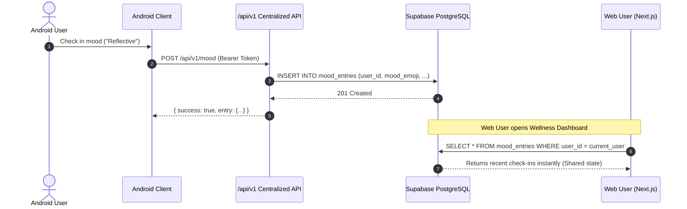

# C.A.L.M Spaces — Backend Architecture

## 1. Executive Summary & Core Principle

The C.A.L.M Spaces digital ecosystem connects the **Web Portal (Next.js)**, **Mobile Application (Android / React Native reference)**, **Admin & Faculty Management Panel**, and **Peer/Expert Workspaces** to a single, centralized backend powered by **Supabase (PostgreSQL 15+)**.

```
+-----------------------------------------------------------------------------------+
|                                 CLIENT PLATFORMS                                  |
|                                                                                   |
|  [ Next.js 15 Web Portal ]     [ Android / Mobile App ]     [ Admin / Staff UI ]  |
|   - Student Wellness Hub        - Native Kotlin / RN App     - Role-Based Portal  |
|   - Appointments & Booking      - Quick Check-in & Journal   - Clinical Analytics |
|   - Realtime Community Wall     - Push Notifications (FCM)   - Content Management |
+-----------------------------------------------------------------------------------+
                                          |
                      HTTPS REST / SSR / Bearer Tokens
                                          v
+-----------------------------------------------------------------------------------+
|                    SHARED BACKEND & API LAYER (/api/v1)                           |
|                                                                                   |
|  - Auth & Session Resolution (Cookie for Web, Bearer Token for Mobile)           |
|  - Input Validation (Zod Schemas)                                                 |
|  - Offline / Self-Healing Graceful Fallback Layer (isSupabaseConfigured)         |
|  - Role Normalization Engine (STUDENT, PEER_LISTENER, EXPERT, ADMIN, SUPER_ADMIN)|
|  - Rate Limiting & Audit Logging                                                  |
+-----------------------------------------------------------------------------------+
                                          |
                        PostgREST / Supabase Client SDK
                                          v
+-----------------------------------------------------------------------------------+
|                        CENTRALIZED SUPABASE BACKEND                               |
|                                                                                   |
|  +------------------------+  +------------------------+  +---------------------+  |
|  |     PostgreSQL DB      |  |     Supabase Auth      |  |  Supabase Storage   |  |
|  | - Canonical profiles   |  | - auth.users UUID      |  | - avatars (public)  |  |
|  | - community_post       |  | - JWT Session tokens   |  | - resources (public)|  |
|  | - book_request         |  | - Password / OAuth     |  | - journals (private)|  |
|  | - expert/student_sched |  +------------------------+  +---------------------+  |
|  | - notifications        |                                                       |
|  | - journal_entries      |  +------------------------+  +---------------------+  |
|  | - CMS tables & Audit   |  |   Supabase Realtime    |  | Triggers & Functions|  |
|  +------------------------+  | - notifications        |  | - sync_profile_dual |  |
|                              | - community_post       |  | - on_auth_created   |  |
|                              | - book_request         |  | - touch_updated_at  |  |
|                              +------------------------+  +---------------------+  |
+-----------------------------------------------------------------------------------+
```

---

## 2. Platform Integrations

### 2.1 Next.js 15 Web Portal
* **Framework**: Next.js 15 App Router with TypeScript.
* **Authentication**: Supabase SSR (`@supabase/ssr`) with encrypted HTTP-only session cookies.
* **Access Control**: Dynamic route proxy (`proxy.ts`) verifying canonical user roles (`STUDENT`, `PEER_LISTENER`, `EXPERT`, `ADMIN`, `SUPER_ADMIN`).
* **Realtime Subscriptions**: React hooks (`useRealtimeTable`, `useRealtimeEventCapacity`) listening directly to PostgreSQL publication changes.

### 2.2 Mobile Application (Android / React Native)
* **Client Architecture**: Mobile client authenticating with Supabase Auth via standard email/password or OAuth.
* **Token Handshake**: Requests pass `Authorization: Bearer <access_token>` to `/api/v1/*` endpoints.
* **Dual-Field Synchronization**: Preserves existing mobile database fields (`name`, `type`, `course`, `registration_number`, `profile_picture_index`) while keeping them in sync with web fields (`full_name`, `role`, `department`, `student_id`).

---

## 3. Centralized Business Logic Layer

1. **Canonical Identity**: All records reference `auth.users(id)` as the foreign key `user_id`.
2. **Dual-Field Profile Sync**: A PostgreSQL trigger `sync_profile_dual_fields()` maintains parity between Web and Mobile profile column conventions on every INSERT or UPDATE.
3. **Role-Based Workspaces**:
   * Students access the Wellness Dashboard, Community Reflection Wall, Journal, Mood Tracker, and Peer Booking.
   * Verified Peer Listeners access their availability schedule and peer consultation requests.
   * Faculty Experts access clinical appointment schedules, student notes, and case reports.
   * Administrators access analytics, audit logs, CMS controls, and contact submissions.
4. **Graceful Degradation**: When environment variables are missing during local development or network outages, the API layer provides structured 503 fallback responses without crashing the server.

---

## 4. Cross-Platform Data Flow



---

## 5. External Integrations
* **Firebase Cloud Messaging (FCM)**: Stored device tokens in `public.push_tokens` for push alerts triggered via Supabase database webhooks.
* **Audit Logging**: All administrative changes, status updates, and flagged content are persisted to `public.audit_logs`.
