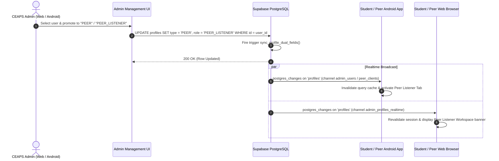
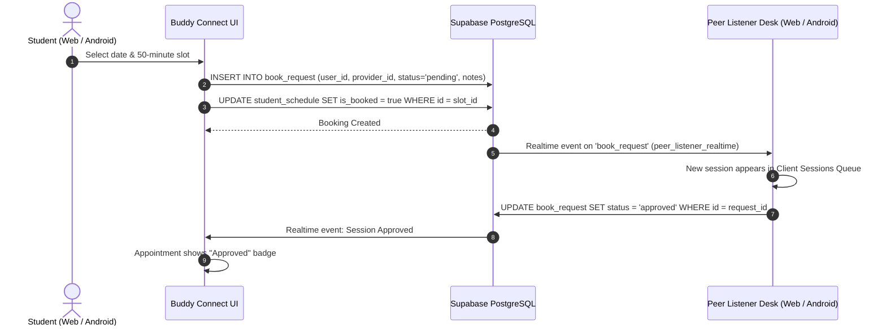

# C.A.L.M Spaces — Backend & Four-Panel Synchronization Architecture

## 1. Executive Summary & Core Principle

The C.A.L.M Spaces digital ecosystem connects the **Web Portal (Next.js 16)**, **Mobile Application (Android / React Native reference on Google Play Store)**, **Admin & Faculty Management Panel**, **Clinical Expert Panel**, **Peer Listener Workspace**, and **Student Wellness Hub** to a single, authoritative backend powered by **Supabase (PostgreSQL 15+)**.

```
+---------------------------------------------------------------------------------------------------------+
|                                           CLIENT PLATFORMS                                              |
|                                                                                                         |
|  [ Student Panel ]       [ Peer Listener Desk ]     [ Clinical Expert Panel ]    [ Admin Control Panel] |
|   - Mood check-ins        - Client sessions queue    - Clinical consultations     - 4-panel user stats  |
|   - Private journal       - 50-min listening slots   - Working slots scheduler    - Role promotion/mgmt |
|   - Buddy connect         - Supervised escrows       - Broadcast announcements    - Wall moderation     |
|   - Campus wall & SOS     - Realtime booking sync    - Realtime request sync      - Platform CMS & audit|
+---------------------------------------------------------------------------------------------------------+
                                                     |
                                   HTTPS / PostgREST / Realtime WebSockets
                                                     v
+---------------------------------------------------------------------------------------------------------+
|                                    CENTRALIZED SUPABASE BACKEND                                         |
|                                                                                                         |
|  +--------------------------------+  +--------------------------------+  +----------------------------+ |
|  |       PostgreSQL Database      |  |        Supabase Auth           |  |      Supabase Storage      | |
|  | - public.profiles              |  | - Canonical auth.users UUID    |  | - avatars (public)         | |
|  | - public.book_request          |  | - Email + Reg No resolution    |  | - resources (public)       | |
|  | - public.expert_schedule       |  | - Encrypted JWT tokens         |  | - library_pdfs (public)    | |
|  | - public.student_schedule      |  +--------------------------------+  +----------------------------+ |
|  | - public.mood_entries          |                                                                     |
|  | - public.journal_entries       |  +--------------------------------+  +----------------------------+ |
|  | - public.community_post        |  |       Supabase Realtime        |  |   Database Triggers & RLS  | |
|  | - public.notifications         |  | - admin_profiles_realtime      |  | - sync_profile_dual_fields | |
|  | - public.messages              |  | - expert_workbench_realtime    |  | - handle_new_user trigger  | |
|  | - CMS tables & audit_logs      |  | - peer_listener_realtime       |  | - Row Level Security (RLS) | |
|  +--------------------------------+  +--------------------------------+  +----------------------------+ |
+---------------------------------------------------------------------------------------------------------+
```

---

## 2. Platform Integrations

### 2.1 Next.js 16 Web Portal
* **Framework**: Next.js 16.3.8 App Router with TypeScript.
* **Authentication**: Supabase SSR (`@supabase/ssr`) with secure cookies. Supports sign-in via institutional email or numeric registration number.
* **Access Control**: Dynamic route proxy (`proxy.ts`) verifying canonical user roles:
  * `ADMIN` & `SUPER_ADMIN` $\rightarrow$ `/admin`
  * `EXPERT` $\rightarrow$ `/expert`
  * `PEER` & `PEER_LISTENER` $\rightarrow$ `/peer-listener`
  * `STUDENT` $\rightarrow$ `/dashboard`
* **Realtime Subscriptions**: Direct WebSocket listeners on `book_request`, `profiles`, and `community_post`.

### 2.2 Mobile Application (Android / React Native)
* **Client Architecture**: Expo Router SDK 52+ client published on Google Play Store.
* **Shared Auth**: Uses the identical Supabase project, resolving registration number lookup via `profiles.registration_number`.
* **Shared Tables**: Directly reads and writes `profiles`, `book_request`, `expert_schedule`, `student_schedule`, and `notifications`.

---

## 3. Four-Panel Data Synchronization & Role Flow

### 3.1 Role Change Synchronization Flow
When an administrator promotes a user (e.g. from Student to Peer Listener or Clinical Expert) on the website or mobile app:



### 3.2 Appointment Booking & Confirmation Flow
When a student books peer or clinical support:



---

## 4. Security & Access Control Model

1. **Canonical Identity**: All records reference `auth.users(id)` as the foreign key `user_id`.
2. **Dual-Field Profile Sync**: A PostgreSQL trigger `sync_profile_dual_fields()` maintains parity between Web and Mobile profile column conventions on every INSERT or UPDATE.
3. **Role Normalization**:
   - `STUDENT`: Self-care, private journal, anonymous wall, appointment requests.
   - `PEER` / `PEER_LISTENER`: Manages availability on `student_schedule`, reviews client requests on `book_request`.
   - `EXPERT`: Manages clinical appointments, updates status, broadcasts alerts on `notifications`.
   - `ADMIN` / `SUPER_ADMIN`: Comprehensive user management, role assignments, community moderation, and platform metrics.
4. **No Service-Role Exposure**: The client application only communicates with Supabase via the public anonymous key (`NEXT_PUBLIC_SUPABASE_ANON_KEY`) subject to PostgreSQL Row Level Security (RLS).
