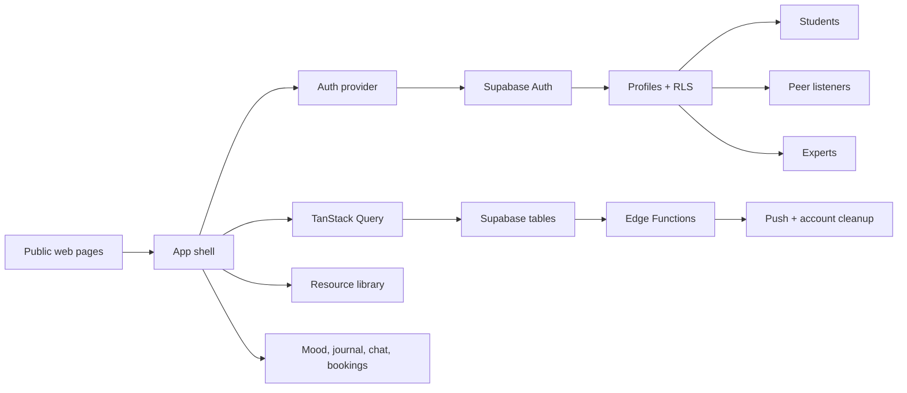

# Calm Spaces Web Architecture

## Objective

Build a public marketing site and a secure authenticated application shell for the same Supabase backend used by the Android app.

## Architecture diagram

## Route structure

### Public

- `/`
- `/about`
- `/features`
- `/resources`
- `/privacy`
- `/terms`
- `/contact`

### Authenticated

- `/dashboard`
- `/mood`
- `/journal`
- `/wellness`
- `/ai-assistant`
- `/buddy-connect`
- `/experts`
- `/appointments`
- `/profile`
- `/settings`
- `/sos`

## Security model

- No service-role credentials in browser code
- Only `NEXT_PUBLIC_SUPABASE_URL` and `NEXT_PUBLIC_SUPABASE_ANON_KEY` exposed client-side
- Business rules enforced by Supabase RLS and server-side edge logic
- Sensitive queries limited to role-based access patterns

## Data flow

- Authenticated browsers request verified data via typed Supabase calls
- TanStack Query centralizes cache, invalidation, and loading states
- UI state never replaces database authorization
- Realtime is supportive; queries remain source of truth

## Component architecture

- Layout and shell
- Auth guard
- Dashboard cards
- Mood chart and data widgets
- Journal editor
- Resource library cards
- Chat and booking forms
- Settings and profile panels
- Security and empty-state patterns

## Role flow

- Student: dashboard, mood, journal, tools, support, AI, appointments
- Peer Listener: availability, clients, sessions, messaging, safety escalation
- Expert: dashboard, consultation, education, scheduling, case review
- Admin: user management, moderation, operational reporting

## Deployment readiness

- Production env vars to be provided by deployment environment
- Supabase project is the authoritative backend
- Domain and auth redirect config must be set in Supabase for the deployed subdomain

